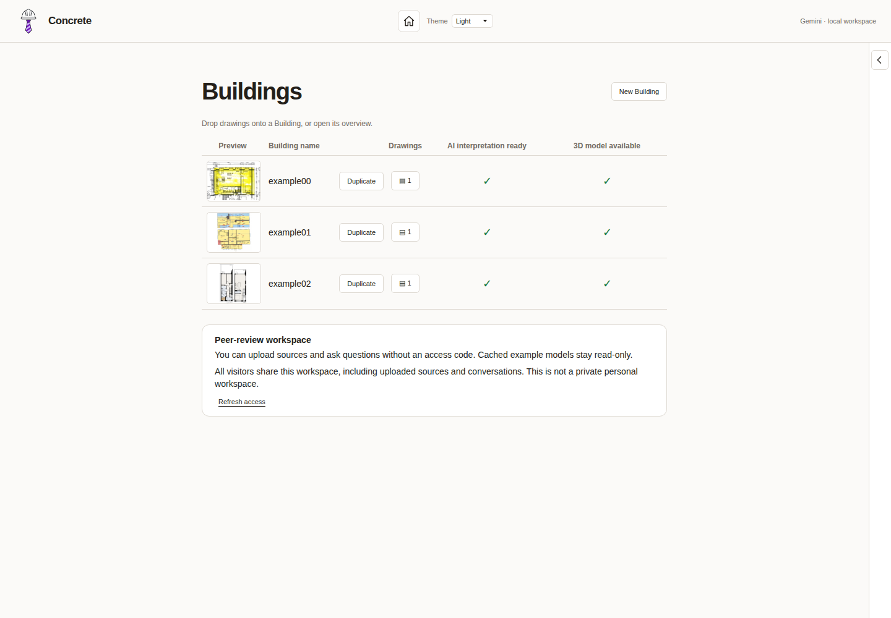
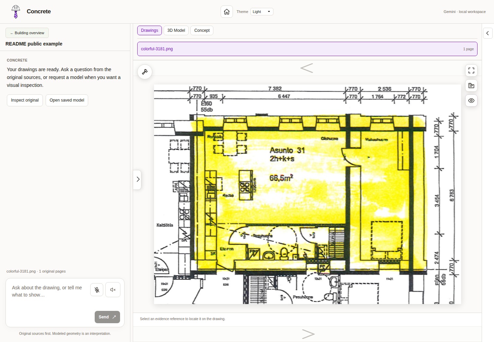
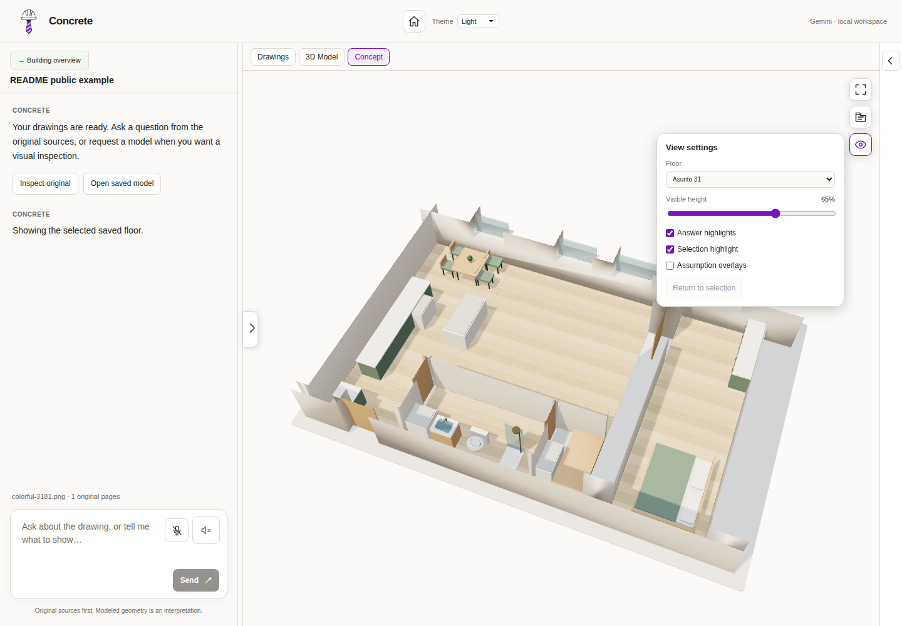

# Concrete

Concrete turns building drawings into an interactive workspace. Upload a floor plan, ask the Gemini vision-language model questions about what it shows, and reconstruct a schematic 3D model you can inspect alongside the original.

## Get started

- **Hosted demo.** Open the [Concrete demo](https://agentic.95.133.254.90.sslip.io/). You can browse the saved examples from **Buildings**. To upload, build a model, or ask a question, enter the demo code under **Access code** and select **Unlock workspace** if prompted. The hosted workspace is shared, so use a sample drawing or a file you can share.
- **Local app.** Follow [Run Concrete locally](#run-concrete-locally) to use your own Gemini credentials.
- **Sample floor plan.** For a quick hosted test, open the matching cached Building from **Buildings**. For local upload tests, download [cubicasa5k-preview.zip](https://github.com/Programmercloud-cmd/JunctionHack26/releases/download/v0.1.0/cubicasa5k-preview.zip), unzip it, and try `cubicasa5k/colorful-11397.png`. The hosted demo protects its pinned examples from re-upload; use your own independent drawing for a hosted upload. The archive includes all 241 CubiCasa5K PNGs in the Junction preview dataset and their credits in `LICENSE.md`. The images are licensed [CC BY-NC-SA 4.0](https://creativecommons.org/licenses/by-nc-sa/4.0/).

## Upload an image, build a model, and ask a question

1. **Create a Building.** On **Buildings**, click **New Building**, enter a **Building name**, and click **Create Building**. This opens its overview.
2. **Upload your floor plan.** Click **Upload drawings** and choose a PNG or JPG, or drop it in the upload area. Concrete saves the original and starts interpreting it automatically. When the filename appears under **Drawings**, click it to open the drawing and its chat. You can also start a fresh conversation with **New chat** under **Chats**.
3. **Reconstruct it in 3D.** Select **3D Model** above the drawing, then click **Build model** in the conversation. Follow progress in **Active tasks**. Open the task card and click **Stop task** to end the job. When a model is ready, open **3D Model** to view it, drag to orbit, and scroll to zoom. Open **View settings** to choose a floor or slice the view with **Visible height**.
4. **Ask the VLM about the original.** Type a question in **Message Concrete**, such as “What labeled spaces are shown on this drawing?” and click **Send** or press Enter. Click a citation in the answer to open the referenced region of the original. Expand **Evidence and checks** for the support review, calculations, or missing information when available. You can also ask questions while 3D reconstruction is running.

Use **Building overview** to return to your drawings and saved chats. Uploading more drawings adds them to the Building’s shared source group for all its chats. **Drawings** opens a file picker below the tab; the large previous/next arrows above/below the drawing switch files while preserving the chat and unsent draft. PDF page controls remain separate. Reopening saved sources or models and changing views do not start inference.

Old independently saved drawing groups appear as separate Building entries, preserving their chats, revisions, models and marks. Source-free chats stay in an empty/General Building until drawings are intentionally uploaded there. Genuine native IFC remains separate from drawing groups. See [Buildings and shared drawings](docs/BUILDINGS_SHARED_DRAWINGS.md).

## Workspace gallery

**Buildings.** Browse saved examples and open a Building’s drawings and chats.



**Original drawings.** Inspect an original and choose which drawing to display.



**Interactive 3D.** View settings exposes Floor and Visible height; slicing clips the displayed model without changing its geometry.



The gallery uses public CubiCasa5K samples. Source drawings © 2019 CubiCasa, CC BY-NC-SA 4.0; [screenshot credits](docs/images/README.md). The 3D view is a schematic interpretation, not verified building geometry.

## What you can do

- **Inspect drawings.** Upload JPG, PNG, PDF, SVG, or DXF. Add related drawings to one Building, browse the originals with **Drawings**, and use **View settings** to switch pages in a PDF.
- **Ask about the source.** Try visible room labels, counts, or dimensions printed on a plan. The technical answer cites drawing regions or original IFC records when the source supports the answer. Concrete can ask for clarification or identify missing evidence.
- **Explore and export a reconstruction.** Inspect schematic floors, walls, openings, and other features derived from the drawings. Use **Concept** for a styled view or **Files** → **Download IFC** to export the model. To overlay saved geometry on the original, ask Concrete to compare the model with the drawing. Inferred geometry and dimensions can be incomplete, and unknown scale stays unscaled. Use the original drawing to verify details.
- **Open a supplied IFC.** Upload a native IFC as its own Building to explore and ask about its original objects and properties, such as “How many windows are in this IFC model?”
- **Mark up the view.** Open the hammer menu to **Point**, **Draw**, or **Measure** on the drawing or model, then attach a saved mark to a message. Enter measurement values and units explicitly. **Eraser**, **Undo** and **Redo** edit these user marks; originals remain unchanged. Marks stay pinned to their saved page/object and revision. Ask explicitly to use attached measurements; they never become dimensions printed in the source. Conflicting calibration can require clarification. [Marks and provenance](docs/AGENTIC_CHAT_CONTRACT.md#drawing-and-model-marks)
- **Use voice.** Click the microphone to dictate and click again to stop; review the transcript before sending. The speaker icon beside it starts off. With server-side ElevenLabs configured, enable **Read answers aloud** for new normal replies, clarification questions and technical answers, including chats without drawings. Saved history and progress messages are not spoken. [Voice setup](docs/VOICE.md)

## Run Concrete locally

Use a Bash shell with Git, Python 3.12+, and curl. Install system Cairo if you plan to open SVG or DXF files.

```sh
git clone https://github.com/Programmercloud-cmd/JunctionHack26.git
cd JunctionHack26
bash scripts/bootstrap.sh
```

In the repository root, create or edit `.env.local` and set `GEMINI_API_KEY` to your Gemini API key. Keep the key in that local file. If your account uses different model IDs, set the corresponding overrides listed in [`.env.example`](.env.example). Then start the server and open [http://127.0.0.1:8000](http://127.0.0.1:8000).

```sh
bash scripts/dev.sh
```

Restart the server after editing `.env.local`. Uploads, drawing previews, and native IFC viewing work without a key. Automatic interpretation, 3D reconstruction, and answers use server-side Gemini. Drawing requests send source images to Gemini, and native IFC questions can send extracted records. Local originals, models, and chats are saved under `.runtime` by default. Run `.venv/bin/python scripts/doctor.py` to check dependencies and whether credentials are configured.

## Models and rendering

The following are the defaults in [`.env.example`](.env.example), not a claim about every deployment’s configured models. Set IDs available to your Gemini account; existing server environment overrides take precedence. The hosted demo’s release/configuration is tracked separately in [agentic deployment](docs/AGENTIC_DEPLOYMENT.md).

| Capability | Setting | Template default |
| --- | --- | --- |
| Conversation and basic technical QA | `GEMINI_BASIC_MODEL` | `gemini-3.8-flash` |
| Advanced technical QA | `GEMINI_ADVANCED_MODEL` | `gemini-4-hydrogen` |
| Tool routing | `GEMINI_ROUTER_MODEL` | `gemini-3.8-flash` |
| Shared UI actions | `GEMINI_UI_MODEL` | `gemini-3.8-flash` |
| Source interpretation | `GEMINI_INTERPRETATION_MODEL` | `gemini-4-hydrogen` |
| Chat rendering: creator and two reviewers | `GEMINI_RENDER_MODEL` | `gemini-4-hydrogen` |
| Factual support review | `GEMINI_DECISION_MODEL` | `gemini-decision-1` |
| Legacy reconstruction endpoints | `GEMINI_RECONSTRUCTION_MODEL` | `gemini-3.1-pro-preview` |

The router receives the original message and chooses a capability. There is no separate evidence-sufficiency preflight on the product `/api/chat` path. The selected technical worker inspects originals and answers, clarifies, or reports insufficient/unclear evidence; factual answers also receive support review and local reference/calculation checks. Ordinary factual QA uses three calls, or five for one correction/re-review. Shared UI requests can add calls. No provider failover is automatic.

**Build model** uses one fixed creator followed by **two independent reviewers in parallel**: three model calls per valid full round, separate from routing and upload interpretation. Both reviewers must support the same reopened IFC candidate before publication, and both must be satisfied to finish. Otherwise combined feedback returns to the creator. The loop has no total time, round or cost cap; individual provider-call limits still apply. Operational failures retry visibly while retaining originals and the last usable model. **Stop task**, shutdown or a source/revision interruption prevents late publication. Reviewer agreement does not establish building accuracy. [Rendering contract](docs/AGENTIC_CHAT_CONTRACT.md#rendering)

For voice output, set `ELEVENLABS_API_KEY` and `ELEVENLABS_VOICE_ID` in the server environment (`.env.local` locally) and restart. `ELEVENLABS_MODEL_ID` defaults to `eleven_multilingual_v2`; transcription uses `GEMINI_API_KEY`. Visitors to the configured shared demo do not supply personal provider keys. Readiness checks report configuration, not verified provider access. [Voice behavior and setup](docs/VOICE.md)

## Storage and public access

Concrete is a single-process hackathon app with durable filesystem bundles, not a database or per-user account system. `BLUEPRINT_STORAGE_ROOT` defaults to `.runtime`; saved originals, pages, source/model revisions, jobs, chats and marks survive restart. Restart interrupts unfinished operations. Keep local development bound to loopback.

Public-demo mode exposes exact pinned examples for inspection. Uploads, paid questions and edits normally require the shared access code; the operator can configure an explicit open window. Code holders and visitors during an open window share the same privileged workspace. Cached example models remain read-only. Scoped uploads, access checks and same-origin protections stay enabled. See [deployment and operator access policy](docs/AGENTIC_DEPLOYMENT.md#peer-review-access-window); the README does not override that policy.

## Limits and troubleshooting

- Drawings are limited to 10 MiB each, with up to five pages per PDF. Input images over 40 megapixels are rejected. Uncompressed IFC STEP uploads are limited to 25 MiB, 4,000 render-catalog elements, and one million triangles. For DWG, export to a supported format before uploading. [Source formats](docs/SOURCE_FORMATS.md)
- If Gemini reports an error, check your key and model access. The agentic path has separately configurable models for interpretation, routing, basic and advanced QA, UI actions, reconstruction, and support review. The doctor checks key presence only. [Model settings](.env.example)
- Generated IFC and Concept styling are derived visualizations, not original-source facts. Unknown scale stays unscaled; assumed heights, missing features and uncertain alignment remain disclosed. Room polygons do not imply walls or enclosure. Source comparison uses the actual reopened IFC to expose omissions or invented geometry; a valid file or reviewer agreement does not prove fidelity.
- User measurements remain attributed inputs. A supplied vertical height does not establish horizontal scale; generated dimensions are not measured drawing facts. Operational/provider errors never mean insufficient evidence.
- QA keeps its separate execution budget: advanced answers can use the remaining overall QA budget, while basic drafts retain their per-call ceiling. Advanced thinking uses the model default unless explicitly overridden. Render loops and legacy reconstruction settings are separate; see [`.env.example`](.env.example).
- For details on shared Buildings, model fidelity, or deployment, see [Buildings and shared drawings](docs/BUILDINGS_SHARED_DRAWINGS.md), [fidelity results](docs/SCHEMATIC_FIDELITY_RESULTS.md), and [agentic deployment](docs/AGENTIC_DEPLOYMENT.md).

## Development checks

```sh
bash scripts/test.sh
```

To run browser checks with injected providers and Chromium, install the optional browser requirements.

```sh
.venv/bin/python -m pip install -r requirements-browser.txt
.venv/bin/python -m playwright install chromium
RUN_BROWSER_TESTS=1 bash scripts/test.sh \
  tests/test_buildings_shared_browser.py tests/test_drawing_navigation_browser.py \
  tests/test_public_workspace_controls_browser.py tests/test_chat_speech_browser.py \
  tests/test_agent_e2e_browser.py
```

Browser tests skip by default and use injected providers; they verify product behavior, not general Gemini accuracy or real ElevenLabs quality. Current live checks and known fidelity gaps are recorded in [deployment verification](docs/AGENTIC_DEPLOYMENT.md), [source-first results](docs/SOURCE_FIRST_VERIFICATION.md) and [voice verification](docs/VOICE_VERIFICATION.md).

The bootstrap installs pinned `requirements.txt` into `.venv`; direct dependencies are in `requirements.in`. There is no frontend build tool or external rendering service. Three.js is pinned locally.

## Counting benchmark

With the app's Gemini credential configured and the full Junction dataset in `junction-dataset/`, run from the repository root:

```sh
PYTHONPATH=. .venv/bin/python evaluation/counting/benchmark.py
```

The default run samples three PDF and three PNG counting questions and scores exact matches. Add `--type length` or `--type area` to sample six original PDFs of that question type and score answers within 2% of the reference after unit conversion. The dataset has no PNG rows for those two types. IFC area rows are outside this drawing-interpretation workflow.

The benchmark uploads the originals to an isolated app store, waits for interpretation, and runs the legacy single-file `/api/chat/actions` and `/api/questions` compatibility pipeline. It is not a measurement of the current `/api/chat` tool-routing or rendering loop. The terminal shows model-call progress, separate upload and question timings, and scores. The run directory printed at startup contains the sample manifest and per-case results.

For the two-call experiment, add `--pipeline interpretation-only`. It samples ten questions per group (PDF count, PNG count, PDF length, and PDF area). Gemini 4 Hydrogen builds a question-independent interpretation from each original drawing, then receives the saved `interpretations.json` and exact question to produce a structured numeric answer. The second call uses the JSON as its evidence. This mode skips chat routing, intent resolution, Gemini Decisions, and answer review. Its run directory includes `results.html` with a combined counting score and per-case results.

The CubiCasa5K preview download above contains sample PNGs and credits; it is not the full Junction benchmark dataset with PDF questions. Keep evaluation answers outside runtime model context.

## License and implementation notes

Application code is [MIT licensed](LICENSE). Dataset assets have their own license and attribution, including the CubiCasa5K archive’s `LICENSE.md`; the code license does not replace those terms.

Contributors should read [AGENTS.md](AGENTS.md), [the source-first contract](docs/SOURCE_FIRST_CONTRACT.md) and [the handoff](docs/HANDOFF.md). These distinguish current product behavior, historical compatibility paths, tested integration and remaining fidelity limits.

## Repository branches

`main` contains the current Concrete application. The previous main is preserved at [archive/main-before-agentic-2026-11-15](https://github.com/Programmercloud-cmd/JunctionHack26/tree/archive/main-before-agentic-2026-11-15).
